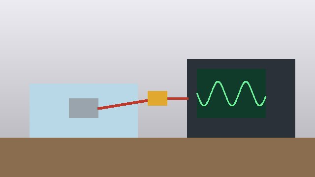

All three response profiles held within the configured target band across
a 30-minute run. No anomalies observed. The set-up is shown in
[[#bench-setup]].



```caption
kind: figure
id: bench-setup
text: Bench set-up. The implant in a saline tank drives the ECAP simulator;
  the current probe (PCP-0087) feeds the oscilloscope.
```
